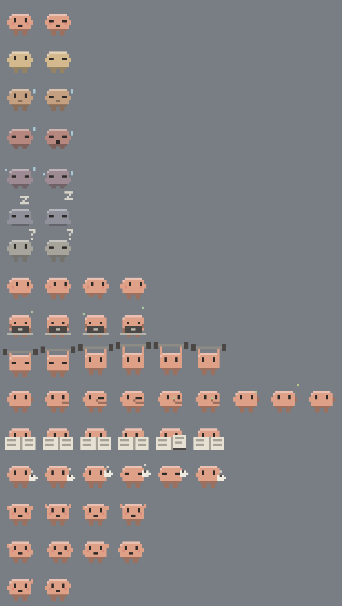

# Cuadrito

A tiny pixel buddy that floats on your desktop and shows how much of your Claude **5-hour** and **weekly** limits you have used, so you stop opening *Settings → Usage*. It works for your whole account: chat, Cowork and Claude Code.

> **Unofficial.** Cuadrito is a community project. It is not made, endorsed or supported by Anthropic. It reads the same usage data as the claude.ai settings page through a private endpoint, which can change without notice.

*[Leer en español](#español)*



## What it does

- **Always visible**, above every window, without stealing focus from what you are typing in.
- **Tap the character** to unfold the panel, tap it again to fold it back.
- **Drag** it anywhere. **Resize** the panel from any edge or corner; the layout adapts.
- **Semi-transparent** panel: use the `◐` button or the right-click menu.
- **Updates by itself**: every 30 s with the panel open, every 60 s as a character. The reset countdown moves every second.
- **Activities** (on by default): it stays in its spot and codes on a laptop, lifts weights, picks its nose, reads the paper, sips coffee, dances and does pirouettes. When it gets tired it drops the energetic ones, and past 92% it does nothing but rest.
- **Wander** (off by default): it walks around the whole screen, slower as it tires, and waits when your pointer comes close so it never slides under a click. Turn on both and it stops along the way to do activities.
- **Its face follows your usage**, driven by whichever limit is closest to running out:

| Used | Mood |
| --- | --- |
| up to 40% | happy |
| up to 60% | content |
| up to 80% | worried |
| up to 92% | tired |
| up to 99% | exhausted |
| 100% | asleep |

## Install

### Do it yourself

1. **Download it:** [Windows](https://github.com/mrlyprojects/cuadrito/releases/latest/download/Cuadrito-windows.exe) or [Mac with Apple chip](https://github.com/mrlyprojects/cuadrito/releases/latest/download/Cuadrito-mac-arm64.dmg).
2. **Put it somewhere permanent.** On Windows, move the `.exe` to a folder such as *Documents*, because it runs from there. On Mac, open the `.dmg` and drag Cuadrito to *Applications*.
3. **Open it.** On Windows the first launch can take about 15 seconds. The builds are not code-signed, so your system may warn you:
   - Windows: *More info → Run anyway*.
   - Mac: *System Settings → Privacy & Security → Open Anyway*.
4. **Sign in to Claude** in the window that appears, with your usual account.
5. **Tap the character** to fold or unfold the panel. Right-click it for everything else.

To remove it: right-click → **Sign out**, then **Quit**, and delete the file. On Windows your settings stay in `%APPDATA%\Cuadrito` until you delete that folder too.

The Windows build is what the author tests. The Mac build is produced automatically and has not been tested by the author yet.

### Or ask Claude to do it

Paste this into **Claude Code**, or any Claude that can run commands on your computer. The regular chat can't install anything, so use the steps above there.

```text
Install Cuadrito on this computer. It is an unofficial open-source app from
https://github.com/mrlyprojects/cuadrito

1. Read the README and tell me in one sentence what it does.
2. Download the latest release for my system from
   https://github.com/mrlyprojects/cuadrito/releases/latest
3. Put it somewhere permanent (Documents on Windows, Applications on Mac) and open it.
4. Don't turn off or bypass any security warning: explain it and let me decide.
5. Never ask for or type my password. I will sign in to Claude myself in the
   window the app opens.
6. When it's open, tell me where you saved it and how to remove it.
```

### Use it

Right-click the character, or use its tray icon, for activities, wander, transparency, size, start with the system, sign out and quit.

## Privacy

- You sign in on claude.ai itself, inside a window of the app. Cuadrito never sees your password.
- The session stays on your computer, in the app's own storage. **Sign out** in the menu erases it.
- The app only talks to `claude.ai`. It has no analytics and no server of its own.

## Customize the expressions

Right-click → **Customize expressions**. That opens `expressions.json`, which redraws the character as you save. Each frame is 16 rows of 16 characters:

```
"....AAAAAAAA....",
"...ABBBBBBBBB...",
"...BBEBBBBEBB...",
"..BBBEBBBBEBBB..",
"..BBBBBBBBBBBB..",
```

| Character | Pixel |
| --- | --- |
| `.` | transparent |
| `B` `D` `A` | body, shade, light (from the state's `color`) |
| `E` | eyes and mouth |
| `C` | cheeks |
| `S` | sweat |
| `Z` | zzz and marks |
| `K` `L` | dark and light object |
| `M` `G` | metal, code spark |
| `P` `N` | paper, ink |
| `O` `Y` | mug, booger |

For each state you can change `upTo` (the percentage it covers), `color`, `animation` (`blink` or `loop`), `frameMs` and `frames`. Some state must reach `upTo: 100`, and the `unknown` state must stay.

The `activities` list works the same way, and you can add your own: `id`, `frames`, `frameMs`, `loops`, `maxPercent` (above this usage it is too tired for it) and `spin` (turns it around). `walk` holds the walking frames. If the file has a mistake, the app says so and uses the original expressions.

## Develop

```bash
npm install
npm test
npm start
```

`npm run smoke` runs the app with demo data and saves PNG captures. `npx electron scripts/preview.js sheet.png` draws every frame on one sheet. `npm run dist` builds the app. Pushing a tag such as `v0.1.0` publishes the Windows and Mac builds through GitHub Actions.

## License

MIT

---

## Español

Un personajito pixelado que flota en tu escritorio y te muestra cuánto llevas usado de tus límites de Claude de **5 horas** y **semanal**, para no tener que entrar a *Configuración → Uso*. Funciona con toda tu cuenta: chat, Cowork y Claude Code.

> **No oficial.** Cuadrito es un proyecto de la comunidad. Anthropic no lo creó, ni lo respalda, ni le da soporte. Lee los mismos datos de uso que la página de configuración de claude.ai mediante un endpoint privado, que puede cambiar sin aviso.

### Qué hace

- **Siempre visible**, encima de todas las ventanas, sin quitarle el foco a lo que estés escribiendo.
- **Toca el personaje** para desplegar el panel y otra vez para plegarlo.
- **Arrástralo** a donde quieras. **Cambia el tamaño** del panel desde cualquier borde o esquina; el contenido se adapta.
- **Panel semitransparente**: con el botón `◐` o el menú de clic derecho.
- **Se actualiza solo**: cada 30 s con el panel abierto y cada 60 s como personaje. La cuenta regresiva avanza cada segundo.
- **Actividades** (activadas de inicio): se queda en su sitio programando en una laptop, levantando pesas, sacándose un moco, leyendo el periódico, tomando café, bailando y haciendo piruetas. Cuando se cansa deja las más energéticas, y por encima del 92 % solo descansa.
- **Paseo** (desactivado de inicio): camina por toda la pantalla, más despacio cuanto más cansado está, y se detiene si acercas el puntero para no meterse debajo de un clic. Si activas las dos opciones, se para en el camino a hacer actividades.
- **Su cara sigue tu uso**, según el límite que esté más cerca de agotarse: feliz (hasta 40 %), tranquilo (60 %), preocupado (80 %), cansado (92 %), agotado (99 %) y dormido (100 %).

### Instalar

#### Hazlo tú

1. **Descárgalo:** [Windows](https://github.com/mrlyprojects/cuadrito/releases/latest/download/Cuadrito-windows.exe) o [Mac con chip Apple](https://github.com/mrlyprojects/cuadrito/releases/latest/download/Cuadrito-mac-arm64.dmg).
2. **Déjalo en un lugar fijo.** En Windows, mueve el `.exe` a una carpeta como *Documentos*, porque se ejecuta desde ahí. En Mac, abre el `.dmg` y arrastra Cuadrito a *Aplicaciones*.
3. **Ábrelo.** En Windows, la primera vez puede tardar unos 15 segundos. Los ejecutables no están firmados, así que tu sistema puede avisarte:
   - Windows: *Más información → Ejecutar de todas formas*.
   - Mac: *Ajustes del Sistema → Privacidad y seguridad → Abrir igualmente*.
4. **Inicia sesión en Claude** en la ventana que aparece, con tu cuenta de siempre.
5. **Toca el personaje** para plegar o desplegar el panel. Con clic derecho tienes todo lo demás.

Para quitarlo: clic derecho → **Cerrar sesión**, luego **Salir de Cuadrito**, y borra el archivo. En Windows, tus ajustes quedan en `%APPDATA%\Cuadrito` hasta que borres también esa carpeta.

La versión de Windows es la que prueba el autor. La de Mac se compila automáticamente y el autor todavía no la ha probado.

#### O pídeselo a Claude

Pega esto en **Claude Code**, o en cualquier Claude que pueda ejecutar comandos en tu computadora. El chat normal no puede instalar nada; ahí usa los pasos de arriba.

```text
Instala Cuadrito en esta computadora. Es una app no oficial de código abierto:
https://github.com/mrlyprojects/cuadrito

1. Lee el README y dime en una frase qué hace.
2. Descarga la última versión para mi sistema desde
   https://github.com/mrlyprojects/cuadrito/releases/latest
3. Déjala en un lugar fijo (Documentos en Windows, Aplicaciones en Mac) y ábrela.
4. No desactives ni te saltes ningún aviso de seguridad: explícamelo y déjame decidir.
5. Nunca me pidas ni escribas mi contraseña. Yo inicio sesión en Claude en la
   ventana que abre la app.
6. Cuando esté abierta, dime dónde la guardaste y cómo quitarla.
```

#### Úsalo

Con clic derecho en el personaje, o desde su icono en la bandeja del sistema, tienes actividades, paseo, transparencia, tamaño, inicio con el sistema, cerrar sesión y salir.

### Privacidad

- Inicias sesión en claude.ai, dentro de una ventana de la app. Cuadrito nunca ve tu contraseña.
- La sesión se queda en tu computadora, en el almacenamiento propio de la app. **Cerrar sesión** en el menú la borra.
- La app solo se comunica con `claude.ai`. No tiene analíticas ni servidor propio.

### Personalizar las expresiones

Clic derecho → **Personalizar expresiones**. Se abre `expressions.json`, y el personaje se redibuja al guardar. Cada cuadro son 16 filas de 16 caracteres; la tabla de arriba explica qué significa cada uno. También puedes añadir tus propias actividades a la lista `activities`. Si el archivo tiene un error, la app te avisa y usa las expresiones originales.
